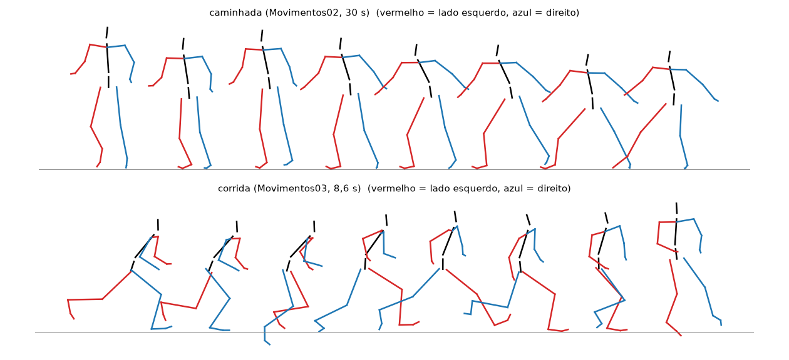

# Plano – Trabalho 4.0: Modelos Hierárquicos com Captura de Movimentos

Grupo 23 – Cristian Alexandre Alchini, Lucas Cardoso Soares e Pedro Henrique De Sena Trombini Taglialenha
INE5420 – Computação Gráfica – 2026/2

**Entrega no Moodle:** segunda-feira, 30/11/2026, até 12:00.
**Defesa:** 01/12 (terça) ou 03/12 (quinta), em https://conferenciaweb.rnp.br/ufsc/lapix. O horário do Grupo 23 ainda precisa ser marcado na planilha.
**Atenção:** a prova teórica é na quinta, 26/11 (08:20–10:00).

## 1. O que é pedido

| Fonte | Exigência |
| --- | --- |
| Enunciado 4.0 (Moodle) | Modelo hierárquico que simule a movimentação de um bicho, robô ou pessoa, com **dois tipos de movimento (andar e correr)**. Pode ser feito em uma game engine, com o personagem modelado no Blender e o esqueleto da engine, ou em OpenGL. |
| Descrição adicional (professor) | O personagem pode ser criado pelo grupo ou ser um modelo pronto (coleção de Pokémons da página). Ele deve ser animado com captura de movimentos (MoCap), **de preferência a da turma**. |
| Página de IA gerativa (LAPIX) | A engine fica "à escolha, tipicamente Unity, Godot ou UE5". O tema sugerido para o personagem é o imaginário de Franklin Cascaes, e o ambiente sugerido são as fortalezas de Anhatomirim ou Ratones. Pede-se uma jogabilidade mínima, com ações que dão pontos. |
| Planilha de avaliação | "Game": Compreensão do problema, Solução, Conhecimento teórico, Algoritmos e Código (2 pontos cada), mais **até +2 por IA gerativa**: +1 pelo uso efetivo, documentado com imagens intermediárias e capturas de tela; +1 pelo resultado realista. |
| Plano de ensino | A defesa conta como prova oral: toda a equipe precisa estar presente e saber explicar a teoria e o código. |

## 2. O que já temos

### 2.1 Capturas da turma (`capturas Aldo 2026.2/`)

- 9 arquivos FBX a 120 fps, todos com o mesmo esqueleto de **28 ossos** (`Elisa:Solving:Hips`, `Spine`, `Head`, braços, pernas, pés e polegares), em escala real: o quadril fica a cerca de 0,85 m do chão.
- A análise automática (`tools/gait_mocap.py`) mediu a velocidade do quadril e as **fases de voo** (os dois pés fora do chão ao mesmo tempo), que distinguem corrida de caminhada. O resultado completo está em `docs/mocap-trechos.json`.

| Movimento | Melhor trecho | Observação |
| --- | --- | --- |
| Caminhada | `Movimentos02.fbx`, 24–42 s (quadros 2882–5042) | 18 s contínuos a ~0,96 m/s, sem voo. Ótimo para um ciclo em loop. |
| Corrida | `Movimentos03.fbx`, 8–11 s (quadros 962–1322) | ~1,8 m/s, com voo em 15–20 amostras por segundo. Outros trechos: `Movimentos06` 19–21 s, `Movimentos04` 17–19 s, `Movimentos02` 10–12 s. |
| Parado (idle) | Início de qualquer take, ou `Elisa_ROM001.fbx` | O ROM (*range of motion*, amplitude de movimento) serve para calibrar e para testar o *rig* (esqueleto de animação). |

**Ponto de atenção:** a sala de captura é pequena (cerca de 5 m × 3 m), então as corridas duram só 2 a 3 s e o corpo vai bem inclinado para a frente, com os braços altos (veja `docs/mocap-candidatos-corrida.png`). Isso basta para extrair um ciclo de corrida em loop. Vocês estavam na sessão: confirmem se algum take foi gravado especificamente como corrida. Se nenhum servir, há corridas nas capturas de outros semestres na página do LAPIX.

### 2.2 Projeto Unreal `Anhatomirim/` (UE 5.5, 5,8 GB)

Ele tem a ilha, personagens (`IKRig-maricota`, `ABP_animacaoFinal`), animações (`Slow_Run`, `Jump`, `Idle`) e um template de terceira pessoa. **A origem precisa ser confirmada:** é de vocês, de outro grupo ou do professor? Ele só faz sentido se escolhermos o Unreal (ver Seção 3).

## 3. Escolha da engine

| | **Godot 4.7 (recomendado)** | Unity 6 | Unreal 5.5 |
| --- | --- | --- | --- |
| Instalação | ~100 MB, portátil, sem conta (**já instalado**) | ~10 GB no D:, conta Unity, administrador | ~60 GB, conta Epic, administrador |
| Formato do projeto | Cenas e scripts em texto (`.tscn`, GDScript): o Claude consegue escrever, rodar e testar quase tudo por linha de comando | C# e cenas em YAML: os scripts dá para escrever, mas montar e testar a cena exige o editor | Blueprints binários: quase tudo é feito manualmente no editor |
| Aceito pela disciplina | Sim (página de IA; jogo em Godot de 2020.1 na galeria de trabalhos) | Sim (aula de 19/11) | Sim |
| Importa as capturas | **Testado:** importou `Movimentos03.fbx` com 28 ossos e 16,7 s de animação | Sim (avatar Humanoid) | Sim (IK Rig/Retargeter) |
| Executável Linux 64 bits | Templates já instalados | Exige o módulo Linux Build Support | Exige toolchain de compilação cruzada |
| Reaproveitamento | — | — | Projeto `Anhatomirim` |

**Recomendação: Blender + Godot 4.7.** Cumpre o enunciado, é aceito, já está instalado e é o caminho em que o Claude consegue fazer e testar a maior parte do trabalho sozinho. Unity faz sentido se o grupo preferir seguir exatamente a aula de 19/11. Unreal, só se o `Anhatomirim` for de vocês e houver tempo para baixar ~60 GB.

## 4. Caminho técnico

1. **Clipes de MoCap (Blender, por script):** recortar parado, caminhada e corrida, ajustar cada um para fechar em loop (pose inicial igual à final) e deixá-los "no lugar", removendo o deslocamento horizontal do quadril. O deslocamento passa a ser feito pelo controlador do jogo.
2. **Personagem:**
   - **A – com IA (vale até +2):** gerar a imagem de conceito de um personagem bípede inspirado em Franklin Cascaes, de frente e em pose T ou A. Transformar a imagem em malha 3D com um serviço de imagem→3D. No Blender, limpar a malha: uma única malha conectada, ~1,7 m de altura e 20 a 40 mil triângulos. Guardar todas as imagens intermediárias, porque o +1 exige essa documentação.
   - **B – modelo pronto:** humano padrão, Steve ou Heracross conectados, da página do LAPIX (se usarem o humano padrão, ele precisa ser "vestido").
3. ***Rigging* (Blender):** encaixar o esqueleto da captura dentro do personagem (mover, escalar e ajustar ossos no *Edit Mode*) e associar a malha com *Automatic Weights*. Testar com o ROM e corrigir os pesos onde a malha deformar mal.
4. **Exportar** um GLB com a malha, o esqueleto e as três animações.
5. **Godot:** personagem como `CharacterBody3D`, com uma `AnimationTree` que mistura parado → andar → correr pela velocidade (`BlendSpace1D`). WASD anda e Shift corre, com câmera em terceira pessoa. Cenário simples no tema da fortaleza, iluminação e itens coletáveis que dão pontos (a jogabilidade mínima).
6. **Builds** para Windows e Linux 64 bits, vídeo de demonstração (reserva para a defesa) e relatório em PDF no formato de artigo, como no Trabalho 2.

## 5. Cronograma

| Data | Tarefa |
| --- | --- |
| Dom 22/11 | Decisões da Seção 8; clipes de MoCap em loop; conceito do personagem com IA |
| Seg 23/11 | Malha 3D do personagem (IA ou modelo pronto) e limpeza no Blender |
| Ter 24/11 | *Rigging* com o esqueleto da captura, pesos, teste com o ROM e exportação GLB |
| Qua 25/11 | Projeto Godot: controlador, `AnimationTree`, câmera e cena básica |
| Qui 26/11 | **Prova teórica de manhã.** Dia leve: iluminação e cenário |
| Sex 27/11 | Coletáveis e pontuação, texturas geradas por IA, polimento |
| Sáb 28/11 | Builds Windows e Linux, vídeo e capturas |
| Dom 29/11 | Relatório (PDF), documentação da IA, ensaio da defesa |
| Seg 30/11 | **Entrega no Moodle até 12:00** |
| 01/12 ou 03/12 | Defesa (marcar o horário do Grupo 23 na planilha) |

**Teoria para a defesa:** árvore de transformações e cinemática direta (matrizes locais e globais dos ossos), *skinning* linear com pesos, como funciona a captura óptica (marcadores, *solving*, FBX/BVH), *retargeting*, mistura de animações e máquina de estados, *root motion* versus animação no lugar, e interpolação de rotações (quatérnios e *slerp*).

## 6. Divisão sugerida

| Quem | Parte |
| --- | --- |
| Claude | Scripts do Blender (clipes, encaixe do esqueleto, pesos, exportação), projeto Godot completo, builds, testes e rascunho do relatório |
| Integrante 1 | Conceito e malha do personagem com IA (exige contas nos serviços) e registro do processo |
| Integrante 2 | Revisão visual da animação e dos pesos no Blender e no jogo; cenário e texturas |
| Integrante 3 | Estudo da teoria para a defesa, vídeo, revisão do relatório e marcação na planilha |

## 7. Ferramentas

| Ferramenta | Para quê | Situação | Onde obter |
| --- | --- | --- | --- |
| Blender 5.3 (portátil) | Clipes, *rigging*, pesos e exportação | **Instalado:** `D:\Programs\blender-5.3.0-windows-x64\blender.exe` | https://www.blender.org/download/ |
| Godot 4.7.2 (portátil) | Engine do jogo | **Instalado:** `D:\Programs\godot-4.7.2\Godot_v4.7.2-stable_win64.exe` | https://godotengine.org/download/windows/ |
| Export templates do Godot 4.7.2 | Gerar executáveis para Windows e Linux | **Instalado** em `%APPDATA%\Godot\export_templates\4.7.2.stable` | https://godotengine.org/download/windows/ (botão "Export templates") |
| Python + uv | Scripts de análise | Já existia | — |
| Gerador de imagens (IA) | Conceito do personagem e texturas | **Precisa de vocês** (conta) | Stable Diffusion, como sugere a disciplina: https://lapix.ufsc.br/stablediffusion/ ; o enunciado também aceita DALL-E/ChatGPT |
| Imagem→3D (IA) | Malha do personagem a partir do conceito | **Precisa de vocês** (conta) | Hunyuan3D-2: https://huggingface.co/spaces/tencent/Hunyuan3D-2 · Meshy: https://www.meshy.ai · Tripo: https://www.tripo3d.ai |
| Modelos prontos LAPIX (se não usarem IA) | Personagem pronto | Download livre | https://lapix.ufsc.br/computacao-graficatrabalhando-com-captura-de-movimentos/#Arquivos_de_Modelos_em_Blender |
| *Só se escolherem Unity:* Unity Hub + Unity 6 LTS | Engine | Não instalado: exige conta Unity, administrador e ~10 GB (instalar no D:) | https://unity.com/download |
| *Só se escolherem Unreal:* Epic Games Launcher + UE 5.5 | Abrir o `Anhatomirim` | Não instalado: exige conta Epic, administrador e ~60 GB | https://www.unrealengine.com/download |

## 8. Andamento (21/11)

- **Engine definida: Godot 4.7.**
- **Pronto:** clipes parado, andar e correr em loop, extraídos das capturas da turma; esqueleto limpo de 28 ossos; manequim provisório; projeto Godot jogável (controlador, mistura por velocidade, câmera, fortaleza, tochas, moedas e HUD); 17 testes automáticos passando; vídeo e prints em `docs/`. Detalhes no `README.md`.
- **22/11:** personagem gerado com IA (Stable Diffusion 3.5 → Hunyuan3D-2) e ligado ao esqueleto; já roda no jogo, com os 17 testes passando. Registro do processo em `ia/README.md`.
- **22/11, 00:55:** textura definitiva gerada pelo Hunyuan3D-Paint rodando localmente na RX 9070 XT (ROCm), em 313 s; personagem final no jogo.
- **22/11, 01:20:** animações procedurais (IK) como padrão do WASD, tecla Tab para os clipes da captura, cena automática com as 8 tomadas completas, vídeos MP4, executáveis Windows/Linux testados, 35 testes passando, relatório em PDF. Corrigidos: clipes tocando 4x mais rápido (fps) e corrida da captura "de lado".
- **Falta:** revisão do grupo, ensaio da defesa e entrega no Moodle (30/11, 12:00).

## 9. Decisões pendentes

1. ~~**Engine:** Godot (recomendado), Unity ou Unreal?~~ Godot.
2. ~~**Personagem:**~~ robô-bruxa (Franklin Cascaes) gerado com IA.
3. **`Anhatomirim`:** de onde veio e se deve ser usado.
4. **Takes:** confirmar quais capturas são caminhada e corrida.
5. **Jogabilidade:** coletáveis com pontuação (sugerido) ou só a demonstração dos dois movimentos?
